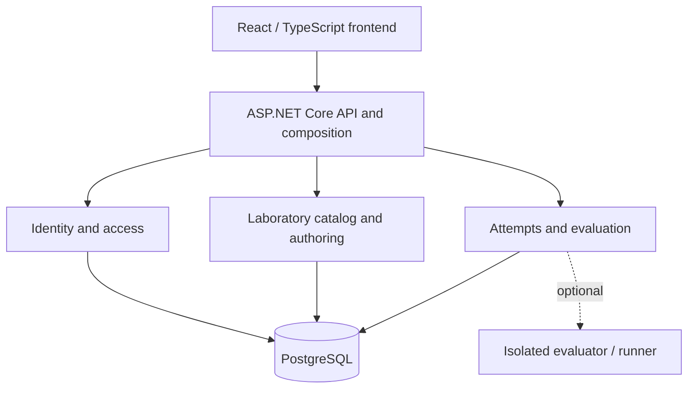

# Conceptual architecture

The platform is designed as a modular monolith. Internal modules communicate through explicit contracts and do not read or modify each other's internal state. This diagram is a starting point for component-level designs.

## Boundaries

- **Identity and access:** user identity, memberships, and resource authorization.
- **Catalog and authoring:** laboratories, revisions, publication, and assignments.
- **Attempts and evaluation:** attempt state, outcome checking, and feedback.
- **Data:** each module owns its invariants and data; access other modules through their contracts.
- **Execution:** an advanced capability in a separate trust boundary, outside the initial core.

Reference contracts include `IIdentityContext`, `IAccessDecision`, `ILabDefinitionReader`, `IAttemptStore`, `ILabEvaluator`, `IAuditWriter`, and optionally `IExecutionGateway`.

Each project component requires its own architecture diagram using the [component template](templates/PROJECT_COMPONENT.md).
