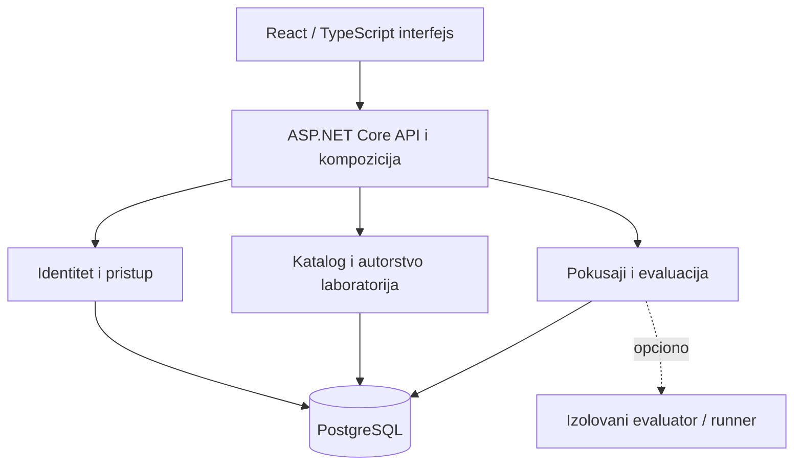

# Konceptualna arhitektura platforme

Polazna osnova: poglavlje 3 nove projektne specifikacije. Predviđen je **modularni monolit**: interni moduli imaju jasne ugovore i ne čitaju/menjaju interno stanje susednih modula. Ovo je referentni dijagram koji studentski timovi treba da razrade za svoj deo.

## Arhitekturne granice

- **Identitet i pristup:** identifikacija korisnika, članstva, provera prava nad resursom.
- **Katalog i autorstvo:** laboratorije, revizije, objavljivanje, dodavanje/dodela vežbi.
- **Pokušaji i evaluacija:** čuvanje stanja, provera ishoda, povratne informacije.
- **Podaci:** modul upravlja sopstvenim invarijantama i podacima; ne pristupati tuđem internom stanju mimo ugovora.
- **Izvršavanje:** napredna mogućnost u zasebnoj granici poverenja, ne deo početnog obaveznog jezgra.

Referentni ugovori iz specifikacije: `IIdentityContext`, `IAccessDecision`, `ILabDefinitionReader`, `IAttemptStore`, `ILabEvaluator`, `IAuditWriter`; opciono `IExecutionGateway`.

Svaka projektna celina izrađuje **svoj dijagram** prema obrascu u `docs/templates/PROJEKTNA_CELINA.md`.
