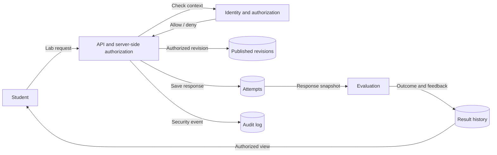
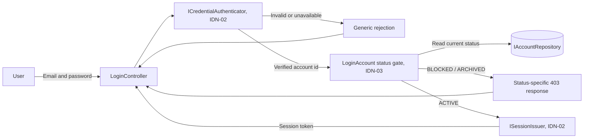

# Data flow — platform-level example

This conceptual example is a starting point. KT1 requires each student to provide a separate DFD for their own component, including its actual processes, actors, and stores.

## Identity login flow (IDN-02 / IDN-03)

The API checks status only after credentials are valid. The current credential
and session adapters fail closed until IDN-02 replaces them.

## Component DFD requirements

1. Input and output data, external actors, and request initiators.
2. Processes and the stores they access.
3. Trust boundaries and server-side authorization checks.
4. Negative flows and handling of sensitive data.
5. The distinction between implemented and planned behavior.
