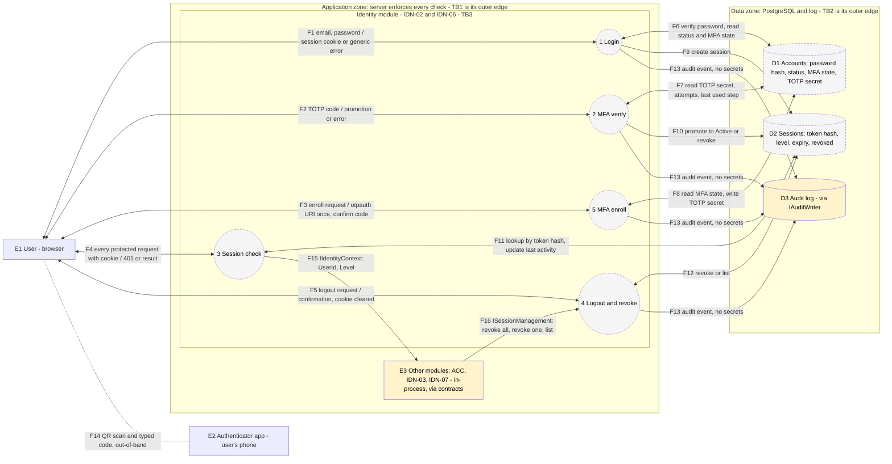

# Data flow diagram: IDN-02 Secure login and logout, IDN-06 MFA

**Team:** 1 (IDN-02 + IDN-06)

**Student:** Nikola Jovanović / PR3-2023 (story US-10, reviewed by the whole team)

**Specification requirements:** IDN-02, IDN-06 (primary), SEC-02, SEC-03, SEC-04, AUD-01, AUD-03, AUD-04, ACC-05, UC-05. Depends on IDN-03 (account status), IDN-05 (attempt limiting) and AUD (audit).

## Responsibilities and boundaries

- Processes and user scenarios:
  - A user logs in with e-mail and password and receives a server-side session (IDN-02).
  - A user with MFA enabled or required receives a `MfaPending` session first, which is promoted to `Active` only after a valid TOTP code (IDN-06).
  - Every protected request is checked against the session store; logout and revocation take effect on the next request (IDN-02, UC-05).
  - A user enrolls a TOTP authenticator by scanning a QR code and confirming the first code (IDN-06).
- Contracts with other modules:
  - Provided: `IIdentityContext`, `ISessionManagement` (code name `ISessionManager`), `IMfaPolicy` (proposed).
  - Used: `IAuditWriter`, account status from IDN-03, attempt limiting from IDN-05.
- Implementation status: see [Implementation status](#implementation-status). On this branch the contracts, fakes and stubs exist; the processes P1 to P5 are planned.

This file covers only the data flow diagram (US-10). The component architecture diagram is a separate story (US-11).

## Data flow diagram

Legend: circle = process, rectangle = external actor or module, cylinder = data store, double-headed arrow = request and response of one named flow, dotted line = out-of-band channel (not a server flow). Dashed grey = planned, not implemented yet. Yellow = stub or fake exists in the repository.

## Elements

### External actors

| ID | Actor | Notes |
|-|-|-|
| E1 | User (browser) | Student, teacher or administrator. Untrusted input. Teacher and administrator have mandatory MFA (proposed, to be confirmed). |
| E2 | Authenticator app | On the user's phone. Receives the TOTP secret from the QR code, shows a 6-digit code. Outside our control. |
| E3 | Other modules (ACC, IDN-03, IDN-07) | In-process consumers. They use only our contracts, never our tables. |

### Processes

| ID | Process | Entry point | Status |
|-|-|-|-|
| P1 | Login | `POST /api/auth/login` (US-04) | planned |
| P2 | MFA verify | `POST /api/auth/mfa/verify` (proposed name, US-18) | planned |
| P5 | MFA enroll | `POST /api/auth/mfa/enroll` and `POST /api/auth/mfa/enroll/confirm` (proposed names, US-17) | planned |
| P3 | Session check | middleware on every protected request, `GET /api/auth/me` (US-06) | planned |
| P4 | Logout and revoke | `POST /api/auth/logout` (US-05), `ISessionManagement` (US-16) | planned |

Process numbers follow the team work plan (P5 is listed after P2 only for layout).

### Data stores

| ID | Store | Content | Status |
|-|-|-|-|
| D1 | Accounts | Password hash (ASP.NET Core Identity), account status, MFA enabled flag, TOTP secret, failed-attempt counter, last used TOTP step | `UserAccount` in memory today (`IAccountRepository`, owned by IDN-03). Database tables planned, physical names pending US-02 and US-12 |
| D2 | Sessions | Hash of the token (never the token), `UserId`, created, expiry, last activity, revoked time, authentication level (`MfaPending` or `Active`), public `SessionHandle` | planned (US-03). `InMemorySessionManagement` fake exists in tests |
| D3 | Audit log | Actor, action, target, time, outcome, correlation ID | `LoggerAuditWriter` writes to the application log. A real store is owned by the AUD team |

## Data flows

| Flow | Direction | Data | Endpoint or contract | Store / table | Status |
|-|-|-|-|-|-|
| F1 | E1 <-> P1 | E-mail and password in. Session cookie (`HttpOnly`, `Secure`, `SameSite`) or one generic error out. The token is never in the response body | `POST /api/auth/login` | none | planned |
| F2 | E1 <-> P2 | 6-digit TOTP code in, requires a `MfaPending` cookie. Promotion or generic error out | `POST /api/auth/mfa/verify` (proposed) | none | planned |
| F3 | E1 <-> P5 | Enroll request. `otpauth://` URI shown once. Confirmation code | `POST /api/auth/mfa/enroll`, `.../enroll/confirm` (proposed) | none | planned |
| F4 | E1 <-> P3 | Cookie on every protected request, CSRF token on state-changing requests (US-15). `401` without reason or the normal response | any protected endpoint, e.g. `GET /api/auth/me` and the existing `PUT /api/admin/accounts/{id}/status` (IDN-03) | none | consumer exists with stub, real check planned |
| F5 | E1 <-> P4 | Logout request. Confirmation and cleared cookie. Idempotent | `POST /api/auth/logout` | none | planned |
| F6 | P1 <-> D1 | Password hash check, account status (blocked and archived are refused), MFA state | ASP.NET Core Identity, `IAccountRepository` | D1 Accounts | in-memory account only |
| F7 | P2 <-> D1 | TOTP secret read, attempt counter and last used step read and updated | MFA service | D1 Accounts | planned |
| F8 | P5 <-> D1 | MFA state read, TOTP secret written after confirmation. Existing secret is never overwritten | MFA service | D1 Accounts | planned |
| F9 | P1 -> D2 | New session with a fresh identifier (session fixation protection), level `MfaPending` or `Active` | session service | D2 Sessions | planned |
| F10 | P2 -> D2 | `MfaPending` to `Active`, or revoke after too many wrong codes | session service | D2 Sessions | planned |
| F11 | P3 <-> D2 | Lookup by token hash on every request, last activity updated, expired or revoked means `401` | session service | D2 Sessions | planned |
| F12 | P4 <-> D2 | Revoke one or all sessions, list active sessions (public handle only) | `ISessionManagement` | D2 Sessions | planned |
| F13 | P1, P2, P4, P5 -> D3 | Login, logout, MFA success and failure, enrollment, revocation. Never passwords, tokens, TOTP secrets or codes. Correlation ID from `HttpContext.TraceIdentifier` | `IAuditWriter.Write(AuditEvent)` | D3 Audit log | writer implemented (application log) |
| F14 | E1 - E2 | QR code scanned with the phone, 6-digit code typed back. Outside the server | none | none | not a server flow |
| F15 | P3 -> E3 | `CallerIdentity`: `IsAuthenticated`, `UserId`, `Level`, `CurrentSessionHandle`. Never token, hash or cookie | `IIdentityContext.Current` | none | contract implemented, stub in Development |
| F16 | E3 -> P4 | Revoke all sessions of a user (IDN-03 block or archive), revoke one by handle and list (IDN-07) | `ISessionManager` (`ISessionManagement` contract) | D2 Sessions | interface implemented, `NoOpSessionRevoker` registered |

## Trust boundaries

| ID | Boundary | Crossed by | Rule |
|-|-|-|-|
| TB1 | Internet / browser and server | F1 to F5 | Everything from E1 is untrusted and validated on the server. The cookie carries only an opaque random token. Hiding screens in the UI is not a control. |
| TB2 | Server and database / log | F6 to F13 | Only the Identity module touches its own tables. Other modules go through contracts (F15, F16). Secrets come from user-secrets or environment, never from code. |
| TB3 | Identity module and other modules (logical, in-process) | F15, F16 | Contracts only. `IIdentityContext` never exposes passwords, tokens or session identifiers. `ISessionManagement` does not decide who may call it, the caller checks permission first. |

The phone (E2) is outside all boundaries. The TOTP secret leaves the server once, in F3, over HTTPS, and the QR code is drawn locally in the browser (no third-party service).

## Negative flows

| Scenario | Flow | Expected result |
|-|-|-|
| Wrong password or unknown account | F1 | Same status and message in both cases, no session, audit event with failure |
| Blocked or archived account | F1, F16 | No new session. Existing sessions already revoked by IDN-03 |
| Old cookie after logout, expired or revoked session, unknown token | F4 | `401` without the reason (IDN-02 criterion) |
| `MfaPending` cookie sent to a protected endpoint (UI bypassed) | F4 | Rejected, `IsAuthenticated` is false until `Active` (IDN-06 criterion) |
| Wrong TOTP code | F2 | Session stays `MfaPending`. After a limited number of attempts it is revoked and temporarily blocked |
| Same TOTP code sent twice in one time window | F2 | Second use rejected (replay) |
| Enrollment when MFA is already enabled | F3 | Rejected, existing secret is not overwritten |
| State-changing request without a valid CSRF token | F4 | Rejected |
| Logout without a valid session | F5 | Idempotent, does not reveal session state |
| Revoking another user's session handle | F16 | Returns false, indistinguishable from an unknown handle |

## Sensitive data

| Data | Where it travels | Handling |
|-|-|-|
| Password | F1 only | HTTPS only, hash checked by ASP.NET Core Identity, never logged or stored in plain text |
| Session token | cookie, F1 to F5 | Generated with a cryptographically secure generator (at least 128 bits). Only its hash is stored in D2. Never in a response body, `IIdentityContext` or logs |
| `SessionHandle` | F12, F15, F16 | Public identifier, not a secret, safe to list |
| TOTP secret | F3 once, D1 | Shown once at enrollment, stored protected (US-22), never logged or returned again |
| TOTP code | F2, F3 | Never logged. Replay and guessing limited |
| CSRF token | F4 | Sent automatically by the frontend, `SameSite` is an additional layer |

## Security requirements

- Server-side access checks: every protected request goes through P3. Endpoints without an explicit policy are denied by default (ACC-05). Privileged roles cannot reach any protected endpoint with a `MfaPending` session.
- Input validation and sensitive data: generic error messages, no secrets in logs or API responses (SEC-02, AUD-03).
- Negative scenarios: see [Negative flows](#negative-flows). Tests are planned in US-13, US-24 and US-25.

## Implementation status

Present in the repository now:

- Contracts: `IIdentityContext` (`CallerIdentity`), `ISessionManager`, `IAuditWriter`, `IAccessDecision`, `AuthenticationLevel` (`None`, `MfaPending`, `Active`).
- Stubs and fakes: `StubIdentityContext` (Development, header `X-Stub-User`), `AnonymousIdentityContext` (other environments), `NoOpSessionRevoker`, `LoggerAuditWriter`, `FakeIdentityContext`, `InMemorySessionManagement`.
- Consumer of our contracts: `PUT /api/admin/accounts/{id}/status` (IDN-03).
- Contract documents: `docs/contracts/IIdentityContext.md`, `docs/contracts/ISessionManagement.md`.

Planned (this DFD describes them, but the code does not exist yet): P1 to P5, D2 Sessions table, MFA columns in D1, endpoints under `/api/auth`.

Open decisions that can change this diagram (to confirm with the assistant): which groups have mandatory MFA, physical table names and DbContext layout, exact MFA endpoint names, how IDN-05 attempt limiting is shared.

## Evidence of work

- Changed files / commit / pull request: `docs/IDN-02_IDN-06_DFD.md` ([PR link])
- Run instructions: open this file on GitHub, the Mermaid diagram renders in the page.
- Tests and results: not applicable to documentation. Each flow is linked to an endpoint, contract or table in [Data flows](#data-flows).
- Team review: [ ] reviewed by the whole team
- Next steps: update flow status and endpoint names as US-03 to US-06 land, add MFA details after US-12 (ADR), final update in US-28 for KT2.