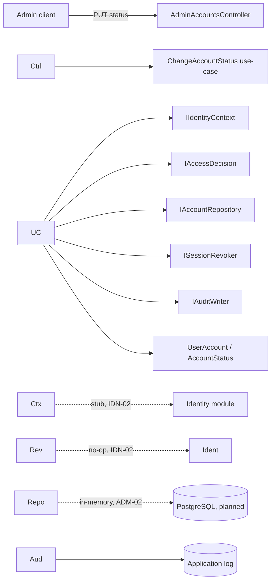
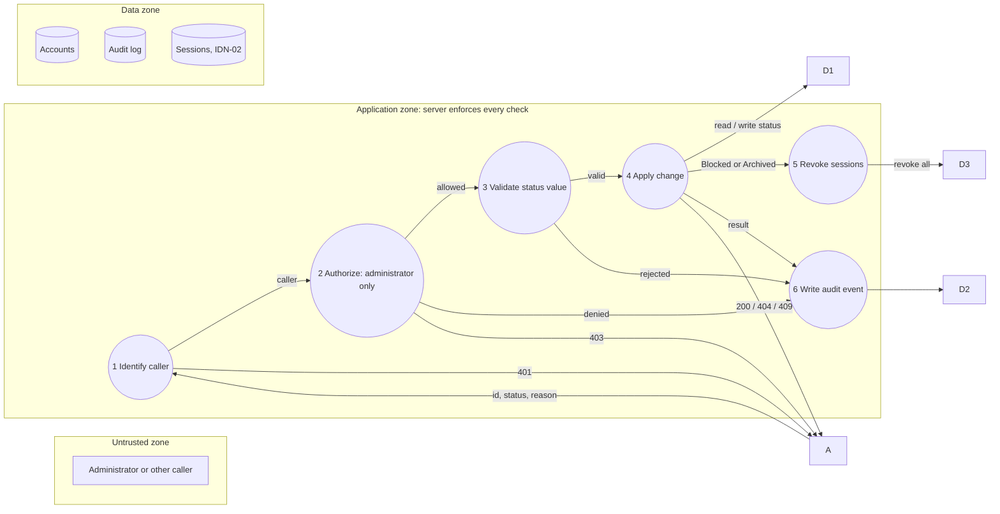

# Project component: IDN-03, Account status management

**Team:** 2

**Student:** Igor Cvijić / PR 21/2023

**Specification requirements:** IDN-03 (primary), ADM-01, AUD-01, AUD-04, ACC-05, SEC-01, UC-05. Depends on IDN-02 (sessions) and ADM-02 (database migrations), see [Status](#implementation-status).

**User story:** As an administrator, I want to change a user account's status to active, blocked or archived, so that I can control access to the system.

## Responsibilities and boundaries

* Processes and user scenarios:

  * An administrator sets the status of another account to `ACTIVE`, `BLOCKED` or `ARCHIVED` (`PUT /api/admin/accounts/{id}/status`).
  * Blocking or archiving revokes all active sessions of that account (UC-05, IDN-03).
  * Every attempt (success, denial, failure) is written as an audit event with actor, action, target, time, outcome and correlation ID.
* Contracts with other modules:

|Contract|Direction|State|
|-|-|-|
|`IIdentityContext`|needs caller identity from IDN-01/IDN-02|**stub** (dev header `X-Stub-User`)|
|`IAccessDecision`|decides who may change status|implemented (administrator only, deny by default)|
|`IAccountRepository`|persistence of accounts|**in-memory**, PostgreSQL pending|
|`ISessionRevoker`|revokes sessions, owned by IDN-02|**no-op stub**|
|`IAuditWriter`|structured security record|implemented (writes to application log)|

* Implementation status: see [Implementation status](#implementation-status).

## Component architecture



Layers: `Controllers/Identity` only translates the result into an HTTP code. `Services/Identity` holds the use-case and the contracts. `Domain/Identity` holds the enum and the entity. Adapters (`Adapters.cs`) are the replaceable technical parts.

## Data flow diagram



Trust boundary: everything coming from the client (id, status, reason, headers) is untrusted input. Identity and permissions are decided only on the server. The response never reveals whether an account exists to a caller who is not an administrator.

Order of checks in the use-case: authenticated, then administrator, then status value valid, then account exists, then not self-change, then not the same status. Authorization comes before the account lookup on purpose.

## Security requirements

* Server-side access checks:

  * `IAccessDecision` allows only administrators, everything else is denied (ACC-05, SEC-01).
  * The check runs inside the use-case, not only in the controller, so any future caller of the use-case is protected too.
  * Outside the Development environment there is no caller at all, so every request returns 401 until real authentication (IDN-02) exists.
* Input validation and sensitive data:

  * The status is accepted only by name (`ACTIVE`, `BLOCKED`, `ARCHIVED`, any letter case). Numbers such as `1` or `99` are rejected, because `Enum.TryParse` would otherwise accept them.
  * The reason is optional, control characters (new lines) are removed and the length is limited to 200, so nobody can forge extra lines in the audit log.
  * The audit event contains no passwords, tokens or session ids (AUD-03).
  * An administrator cannot change their own status, to prevent locking out the last administrator.
* Negative scenarios (misuse, control, test):

|Misuse|Control|Test|
|-|-|-|
|A student or non-admin blocks an account|`IAccessDecision`, 403, denial audited|`NonAdmin\_IsForbidden\_StatusUnchanged\_DenialAudited`|
|Probing which account ids exist|authorization before lookup, same 403 for existing and missing ids|`NonAdmin\_CannotLearnWhetherAccountExists`|
|Request without a caller|401, status unchanged|`NoCaller\_IsUnauthenticated\_StatusUnchanged`|
|Caller flagged unauthenticated but with an admin id|`IsAuthenticated` is checked first|`CallerMarkedNotAuthenticated\_IsUnauthenticated\_EvenIfIdIsAdmin`|
|Invalid or numeric status (`SUPERUSER`, `1`, `99`, empty)|strict parsing, 400|`InvalidStatusValue\_IsRejected\_StatusUnchanged` (6 cases)|
|Unknown account|404, failure audited|`UnknownAccount\_ReturnsNotFound`|
|Administrator blocks themselves|409, denied and audited|`Admin\_CannotChangeOwnStatus`|
|Setting the status it already has|409, no session revocation|`SettingSameStatus\_IsInvalidTransition\_NoRevocation`|
|Forged audit lines through the reason|control characters removed|`Reason\_CannotInjectFakeAuditLines`|
|Blocked or archived account keeps sessions|`ISessionRevoker` called|`Admin\_CanBlockAccount\_...`, `Admin\_CanArchiveAccount\_SessionsRevoked`|
|Reactivation wrongly revokes sessions|revoke only for Blocked and Archived|`Admin\_CanActivateBlockedAccount\_SessionsNotRevoked`|

## Evidence of work

* Changed files / commit / pull request: branch `feature/IDN-03-account-status`, commit `413a53d` (IDN-03: status change with access check and audit record). Pull request: \[link].

  * `backend/Platform.Api/Domain/Identity/`: `AccountStatus.cs`, `UserAccount.cs`
  * `backend/Platform.Api/Services/Identity/`: `ChangeAccountStatus.cs`, interfaces, `Adapters.cs`
  * `backend/Platform.Api/Controllers/Identity/AdminAccountsController.cs`
  * `backend/Platform.Api/Program.cs`, `appsettings.Development.json`
  * `backend/Platform.Tests/Identity/ChangeAccountStatusTests.cs`
* Run instructions (PowerShell, from the repository root):

```powershell
  dotnet build backend\\Platform.Api\\Platform.Api.csproj
  dotnet test backend\\Platform.Tests\\Platform.Tests.csproj

  cd backend\\Platform.Api
  $env:ASPNETCORE\_ENVIRONMENT = "Development"
  dotnet run --urls http://localhost:5080
  ```

  Development seeds three test accounts (`example.com` addresses). Ids: `1111...` administrator, `2222...` student, `3333...` other account. The caller is chosen with the header `X-Stub-User` (development only). Example, in a second terminal:

```powershell
  '{"status":"BLOCKED","reason":"test"}' | curl.exe -s -w " HTTP %{http\_code}`n" -X PUT "http://localhost:5080/api/admin/accounts/33333333-3333-3333-3333-333333333333/status" -H "Content-Type: application/json" -H "X-Stub-User: 11111111-1111-1111-1111-111111111111" --data-binary "@-"
  ```

  Expected: `200` and an `AUDIT` line in the API terminal. With `X-Stub-User: 2222...` the expected result is `403`.

* Tests and results: 17 NUnit test cases in `Platform.Tests/Identity`. Result: \[fill in after running `dotnet test`, expected 17 passed].
* Next steps: see below.

## Implementation status

|Acceptance criterion|Status|
|-|-|
|Administrator can set `ACTIVE`, `BLOCKED` or `ARCHIVED`|Done, covered by tests|
|System stores the new status in the database|**Partial.** Stored behind `IAccountRepository`, currently in memory, so data is lost on restart. PostgreSQL storage and migration (ADM-02) are a separate task|
|Only an authorized administrator can change status|Done, server-side, covered by negative tests|
|The change is recorded|Done, audit event with actor, target, time, outcome and correlation ID. Currently written to the application log|
|Blocking revokes all sessions, new logins are refused (IDN-03)|**Partial.** The use-case calls `ISessionRevoker`, but the implementation is a no-op until IDN-02. Refusing login for blocked or archived accounts belongs to IDN-02|

## Known limitations and residual risk

* In-memory storage, replace `InMemoryAccountRepository` with a PostgreSQL implementation. The use-case and tests stay unchanged.
* `NoOpSessionRevoker` does not revoke anything yet. Until IDN-02 is done, a blocked account keeps working sessions.
* The identity stub trusts the `X-Stub-User` header. It is registered only in the Development environment, and any other environment returns 401 for every request.
* The audit event goes to the application log. A persistent audit store (shared `IAuditWriter` contract) is still to be agreed with the team that owns auditing.
* There is no concurrency control, two administrators changing the same account at the same time result in the last write winning.
* Any status can change to any other different status, including `ARCHIVED` back to `ACTIVE`. This is a conscious simplification, the acceptance criteria do not forbid it.
* No rate limiting on the administrative endpoint (SEC-04).

## Next steps

1. Agree with the owner of IDN-01 and the database task on a single user entity and `DbContext`, then add the PostgreSQL repository and migration.
2. Replace `NoOpSessionRevoker` and the identity stub when IDN-02 is available, and add a contract test against the real implementation.
3. Move `IAuditWriter` to the shared audit contract when it is agreed.
4. Add `dotnet test` to the CI workflow.

