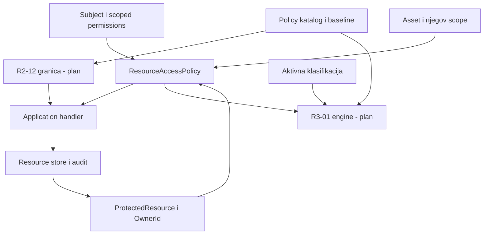

# KT1 - Scope, model i pokrenut projekat

**Tim:** T03 - Object-level i API autorizacija i policy engine. **Termin iz materijala:** kraj 2. nedelje. **Obuhvat:** R1-06, R2-12, R3-01. Oznake su normalizovane na dvocifreni zapis iz specifikacije.

## 1. Obuhvat i tačni preduslovi

| Celina | Naziv iz specifikacije | Direktni preduslovi | Plan faze |
| --- | --- | --- | --- |
| R1-06 | Object-level authorization i vlasništvo resursa | R1-05, R1-02 | Primarna; ključni tok i testovi za KT2 |
| R2-12 | API i application security policies | R1-08, R1-10 | Svi use-case-ovi u backlog-u; granica i model pretnji za KT2; realizacija za KT3 |
| R3-01 | Policy engine i atributska autorizacija | R1-06, R1-07, R1-08 | Svi use-case-ovi u backlog-u; model i ugovori za KT2; prototip za KT3 i obavezni tokovi za KT4 |

R3-01 prema PDF specifikaciji, str. 70, nema samo R1-07 kao preduslov: traži i R1-06 i R1-08. R1-06 je u vlasništvu T03; ostali preduslovi imaju svoje owner-e. Njihove cele use-case-ove ne preuzimamo u scope T03, već dogovaramo minimalne javne ugovore.

Tranzitivno: R1-05 se oslanja na R1-03 (identitet); R1-02 i R1-08 na R1-01 (bezbednosni domeni); R1-10 na R1-02 i R1-08; R1-07 na R1-02. U simulatoru postoje testni identiteti i domeni radi konteksta. To nije završena implementacija tih upstream celina.

## 2. Svi obavezni use-case-ovi i acceptance kriterijumi

Izvor za nazive: SCUTUM specifikacija, str. 31, 56 i 70. Acceptance kriterijumi ispod su konkretizacija za ovaj tim, bez smanjenja normativnog obuhvata. Proširenja poput delegiranja, CORS kataloga i risk-aware politike nisu obavezni KT1/KT2 scope.

### R1-06

| Task | Obavezni use-case | Konkretan acceptance kriterijum | Dokaz u kodu |
| --- | --- | --- | --- |
| T03-006 | provera vlasništva | OwnerId resursa poredi se sa pouzdanim Subject.Id; vlasnik bez dozvole se odbija | ResourceAccessPolicy; OwnerReadsOwnResource, OwnerWithoutPermissionIsDenied |
| T03-007 | provera scope-a | Subject.ScopeId, scope asset-a i scope efektivne dozvole moraju biti usaglašeni | OtherScopeCannotReadEvenWithReadAny; GrantForWrongScopeDoesNotAuthorizeOwner |
| T03-008 | dozvola/odbijanje konkretne operacije | Read, Update i ChangeOwner imaju zasebna pravila; read:any ne daje write | ResourceHandlers; ReadAnyDoesNotAllowWrite |
| T03-009 | promena owner-a | Aktuelni owner sa eksplicitnom dozvolom prenosi resurs aktivnom korisniku istog scope-a; promena i audit su atomski | TransferImmediatelyChangesWhoCanRead; InvalidTargetOwnerDoesNotChangeState |
| T03-010 | negativni pristup tuđem resursu | Poznat ID tuđeg resursa ne vraća sadržaj ni owner podatke; isti javni odgovor kao nepostojeći resurs | OtherOwnerCannotReadByKnownId; MissingAndForeignResourceHaveSamePublicResponse |

### R2-12

| Task | Obavezni use-case | Konkretan acceptance kriterijum | Preduslov / faza |
| --- | --- | --- | --- |
| T03-020 | povezivanje endpoint-a sa policy klasom | Svaki zaštićeni endpoint ima EndpointClass i tačnu aktivnu PolicyId/Version; nepoznata klasa ne daje pristup | R1-08; KT3 |
| T03-021 | provera auth/authz zahteva | Potvrđen i aktivan identitet; endpoint authz poziva R1-06 za konkretan objekat; anonimni ili neovlašćeni zahtev odbijen | R1-08 + R1-06; KT3 |
| T03-022 | rate policy | Limit ima eksplicitan ključ subject + scope + endpoint class i prosleđeno vreme; N zahteva prolazi, N+1 se odbija | R1-08, R1-10; KT3 |
| T03-023 | input size/shape ograničenje | Definisana veličina tela u bajtovima, dozvoljena polja i tipovi; prevelik ili neispravan input se odbija pre use-case-a | R1-08, R1-10; KT3 |
| T03-024 | security configuration check | Aktivna konfiguracija poredi se sa verzionisanim baseline-om; oslabljen auth ili header daje nalaz i negativni test | R1-10 + R1-08; KT3 |

Poslovna provera vlasništva ostaje u R1-06: input validacija iz R2-12 je ne zamenjuje. Za KT3 se bira mali aplikacioni/API adapter ili kontrolisani simulator granice u skladu sa vežbom 3, bez zahteva za produkcionim gateway-em.

### R3-01

| Task | Obavezni use-case | Konkretan acceptance kriterijum | Preduslov / faza |
| --- | --- | --- | --- |
| T03-030 | evaluacija politike | PolicySetVersion, subjekt, resurs i eksplicitni kontekst daju PolicyDecision; bez primenljive allow odluke ishod je deny | R1-06, R1-07, R1-08; prototip KT3 |
| T03-031 | kombinovanje atributa | Atributi identiteta, scope-a, owner-a i aktivne klasifikacije dolaze iz pouzdanih portova; zahtev korisnika ih ne prepisuje | R1-06, R1-07; KT3/KT4 |
| T03-032 | objašnjenje allow/deny razloga | Odluka ima stabilan ReasonCode i objašnjenje dostupno ovlašćenom reviewer-u; klijent ne dobija tuđe atribute | R1-08; KT4 |
| T03-033 | verzionisanje policy seta | Objavljena verzija je nepromenljiva; evaluacija i audit vezani su za konkretnu verziju | R1-08; KT4 |
| T03-034 | testiranje policy scenarija | Tabelarni pozitivni i negativni testovi za isti kontekst, konflikt pravila i nedostajući atribut; rezultat je determinističan | Sve prethodno; KT4 |

Deny-overrides je predloženo pravilo konflikta za budući R3-01: bilo koji relevantan deny nadjačava allow; odsustvo eksplicitnog allow znači deny. To je ADR predlog za realizaciju, ne već implementiran R3 engine.

## 3. Redosled implementacije i Tapiz backlog

`backlog/TAPIZ.csv` je pripremljen za prepis/uvoz kartica: TaskId, Celina, naziv, Acceptance, Preduslovi, Milestone, Prioritet, Owner i Status. Statusi razlikuju pripremljen kod, čekanje provere, plan i review. Nije evidentirana objava na stvarnom Tapiz board-u.

| Redosled | Posao | Zašto prethodi sledećem |
| --- | --- | --- |
| 1 | T03-001 scope + backlog, T03-002 model + matrica | Svi use-case-ovi i pravila moraju biti vidljivi pre implementacije |
| 2 | T03-003 portovi + DRAFT ugovori, T03-004 struktura + CI | Izoluje nedostupne preduslove i daje put provere |
| 3 | T03-005 seed + simulator; T03-006/007 policy | Pristup mora proveravati stvarne fixture resurse i scope |
| 4 | T03-008 čitanje + izmena; T03-009 promena owner-a | Prvi normalan vertikalni tok kroz application i persistence simulator |
| 5 | T03-010 negativni testovi; T03-011 audit + verzija | Dokaz granice, zaštita konkurentnih izmena i trag odluke |
| 6 | T03-012 threat model; T03-013 cross-team review; T03-014 evidence | Pokriva sve dodeljene celine i stavke KT2 |
| 7 | T03-020 do T03-024 R2-12 | Druga celina za KT3 |
| 8 | T03-030 do T03-034 R3-01 | Prototip treće celine KT3, pun obavezni obuhvat KT4 |

## 4. Objedinjeni domen model

| Entitet / pojam | Ključni podaci | Owner podataka | Status / pravilo |
| --- | --- | --- | --- |
| Subject | Id, ScopeId, IsAuthenticated, IsActive, Assurance | R1-03 / pouzdan identity adapter | Aktivan/neaktivan; potvrđena/nepotvrđena sesija |
| ScopedPermission | Permission, ScopeId | R1-05 | Aktuelni snapshot; dozvola nije globalna |
| AssetSnapshot | Id, ScopeId, IsActive | R1-02 | Aktivan/neaktivan; autoritativni scope |
| ProtectedResource | Id, AssetId, OwnerId, Content, Version, Status | T03 / R1-06 | Active/Archived; izmene samo uz expected version |
| ResourceOwner | Veza ProtectedResource.OwnerId -> Subject.Id | T03 / R1-06 | Promena zahteva dozvolu, vlasništvo i validnog novog owner-a |
| AccessDecision | Allowed, Code, Reason | T03 / R1-06 | Čista odluka; nema implicitnog allow |
| OperationResult | Outcome, Code, Message, Resource? | T03 / Application | Deny i nepostojeći resurs imaju isti javni DTO |
| SecurityEvent | Actor, Action, Target, Outcome, Time, Correlation, Sensitivity, PolicyVersion | T03; kasnije consumer R1-09 | Append-only kroz javni interfejs simulatora; interni razlog nije klijentski odgovor |
| ApiSecurityPolicy / EndpointClass | Klasa endpoint-a, auth zahtevi, rate/input/header pravila | T03 / R2-12 | Planirano; referenca na aktivnu R1-08 politiku i R1-10 baseline |
| PolicyReference | PolicyId, Version, Scope, Status, period važenja | R1-08 | Draft/Active/Archived; objavljena verzija ne menja se u mestu |
| BaselineReference | BaselineId, Version, TargetType, PolicyId/Version | R1-10 | Verzija i veza sa politikom |
| ClassificationSnapshot | ResourceId, Level, DataOwnerId, Version | R1-07 | Aktivna klasifikacija; nije klijentski atribut |
| PolicySet / EnvironmentContext | Version; eksplicitno vreme i kontekst | T03 / R3-01 | Planirano; isti kontekst daje isti rezultat |

Termin ResourceOwner iz specifikacije je u kodu predstavljen vezom OwnerId, a Action enum-om ResourceAction. Za KT1 ne treba prazna klasa samo da bi se ponovio naziv pojma.

Tok promene vlasništva: pouzdan Subject -> validacija komande -> efektivne dozvole -> resurs i asset -> provera ownership/scope/action -> provera novog owner-a -> compare-and-swap promena + audit -> kontrolisan DTO. Klijent ne menja upstream tabele niti šalje sopstvene permissions.

## 5. Minimalna security matrica

Ovo su projektne odluke T03, zasnovane na vežbi 1 (dozvola i scope) i vežbi 2 (konkretan resurs). Poznavanje ID-a nikada nije dovoljan osnov.

| Subject | Action | Resource | Allow/Deny | Obrazloženje |
| --- | --- | --- | --- | --- |
| Ana, aktivna, read:own u dom-a | Read | res-001, owner Ana, asset dom-a | Allow | Dozvola + scope + vlasništvo |
| Marko, aktivan, read:own u dom-a | Read | res-001, owner Ana | Deny | Ista uloga nije ownership |
| Ivana, read:any u dom-b | Read | res-001 u dom-a | Deny | Različit security domen |
| Ana, read:own samo u dom-b | Read | njen resurs u dom-a | Deny | Grant ima pogrešan scope |
| Reviewer, read:any u dom-a | Read | res-001 u dom-a | Allow | Eksplicitna scoped dozvola |
| Reviewer, read:any u dom-a | Update | res-001, owner Ana | Deny | Read pravo ne daje write pravo |
| Ana, update:own u dom-a | Update | sopstveni resurs | Allow | Validan input i aktuelna verzija |
| Marko, update:own u dom-a | Update | Anin resurs | Deny | Nije vlasnik |
| Ana, owner:change u dom-a | ChangeOwner | res-001 -> Marko iz dom-a | Allow | Aktuelni owner, validan cilj |
| Ana, owner:change u dom-a | ChangeOwner | res-001 -> Ivana iz dom-b | Deny/Invalid | Novi owner izvan domena |
| Neaktivan ili neprijavljen | bilo koja | zaštićeni resurs | Deny | Status/prethodna potvrda identiteta |
| Bilo koji subject; port nedostupan | bilo koja | zaštićeni resurs | Deny/Unavailable | Fail-closed; bez promene stanja |

Za R2-12/R3-01 planirane odluke: nepoznata endpoint/policy klasa -> deny; prekoračen scoped rate limit -> reject; prevelik input -> reject; nepoznata klasifikacija -> deny; konflikt deny/allow -> deny. To je model, ne dokaz pune realizacije tih celina.

## 6. Međutimske zavisnosti

| Owner celine / podataka | Consumer | Minimalni port | KT1 stanje |
| --- | --- | --- | --- |
| Tim koji poseduje R1-05 | T03 R1-06; kasnije R3-01 | IEffectivePermissionsProvider.GetFor(subjectId) | DRAFT + normalan/missing/unavailable stub |
| Tim koji poseduje R1-02 | T03 R1-06 | IAssetCatalog.Find(assetId) | DRAFT + normalan/missing/unavailable stub |
| Tim koji poseduje R1-03 | T03 ulazni adapter / transfer owner-a | Subject context + ISubjectDirectory | DRAFT + testni identiteti |
| Tim koji poseduje R1-08 | T03 R2-12 i R3-01 | IPolicyCatalog.GetActive(scopeId) | DRAFT DTO/stub; realizacija kasnije |
| Tim koji poseduje R1-10 | T03 R2-12 | IBaselineProvider.GetFor(targetType) | DRAFT DTO/stub |
| Tim koji poseduje R1-07 | T03 R3-01 | IClassificationProvider.GetFor(resourceId) | DRAFT DTO/stub |
| T03 R1-06 | T03 R3-01; API policy i drugi ovlašćeni consumer-i | AccessDecision + application handler | Interna granica; verzija r1-06:v1 |
| T03 audit emitter | Tim koji poseduje R1-09 | SecurityEvent v1 | DRAFT; lokalni audit je implementiran |

Tačni brojevi upstream timova i imena odgovornih osoba nisu u priloženoj dodeli T03. Owner-i su zato navedeni po celini; stvarni identiteti moraju se potvrditi na koordinaciji. Nije označeno da je dogovor već ACCEPTED.

## 7. Repozitorijum, build, CI i praksa rada

Solution ima pet projekata i radi po istom smeru zavisnosti kao primeri iz vežbi. README daje clean-start komande. `.github/workflows/ci.yml` definiše restore, build, NUnit, malu statičku proveru i demo. `.github/pull_request_template.md` zahteva task, security acceptance, dokaz i review.

Predložen tok: Tapiz T03-006 -> `feature/T03-006-object-authorization` -> commit sa TaskId -> PR -> CI + review -> VERIFY/SECURITY QA -> DONE. Direktan push na main se ne koristi. Paket ne sadrži izmišljene remote PR brojeve ili reviewer-e.

**Stanje:** struktura, source i CI konfiguracija su pripremljeni; statička provera i C# sintaksno parsiranje prolaze. Lokalna Git istorija početnog scaffold-a i feature grane je priložena kao bundle. Build i NUnit rezultat treba pribaviti na .NET 8 računaru ili kroz pripremljeni CI jer CoreCLR ne radi u ovom okruženju. Tačka koja zahteva dokaz uspešnog build-a još nije dokazana.

## 8. Prvo izvršivo pravilo i plan KT2

Pravilo u `ResourceAccessPolicy`: aktivan vlasnik mora imati odgovarajuću dozvolu u scope-u asset-a; isti ID ili ista uloga bez vlasništva ne daju pristup. NUnit `OtherOwnerCannotReadByKnownId` poziva aplikacioni handler bez UI-ja i očekuje Denied sa Resource=null. Kod i test su napisani; izvršavanje još nije potvrđeno.

Plan KT2: čitanje -> izmena -> prenos owner-a -> stari owner deny / novi owner allow; seed; strukturisani audit; threat model za sve tri celine; pozitivan i negativan stub ugovor; pregled sa upstream timom; stvarni build/test dokaz.

## 9. Prikaz KT1 u 5-7 minuta

| Vreme | Prikaz |
| --- | --- |
| 0:00-1:00 | T03 scope, svih 15 use-case-ova i kompletni preduslovi |
| 1:00-2:20 | Model vlasništva i scope-a; dve Allow/Deny odluke iz matrice |
| 2:20-3:20 | Portovi, owner/consumer granica i DRAFT stanje |
| 3:20-4:20 | Struktura solution-a i stvarni dotnet build rezultat nakon pokretanja |
| 4:20-5:30 | Jedan negativni NUnit test i kontrolisan DTO |
| 5:30-6:30 | Plan KT2 i poznata ograničenja |

Bez stvarnog build/test loga prikaz te stavke se ne smatra dovršenim samo zato što postoji komanda.
