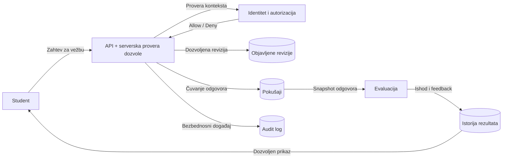

# Dijagram toka podataka — primer na nivou platforme

Ovo je samo početni, konceptualni primer toka. **KT1 zahteva zaseban DFD za deo svakog studenta**, sa stvarnim procesima, akterima i skladištima tog dela.

## Šta je obavezno označiti u sopstvenom DFD-u

1. Ulazne i izlazne podatke, spoljne aktere i inicijatore zahteva.
2. Procese koji obrađuju podatke i skladišta kojima pristupaju.
3. Granice poverenja i tačke serverske provere autorizacije.
4. Negativan tok (odbijen zahtev / greška) i postupanje sa osetljivim podacima.
5. Šta je već implementirano, a šta je planirano.
