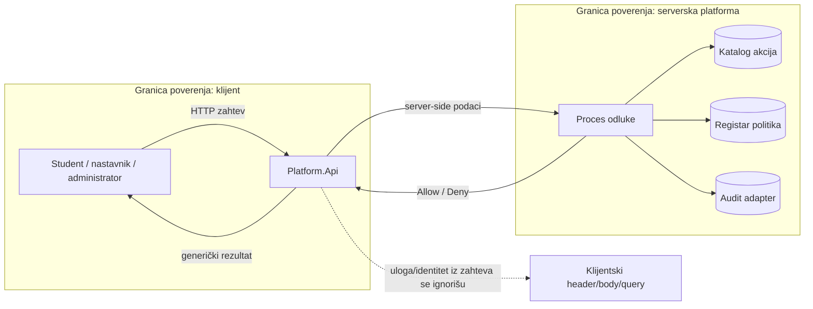

# ACC-05 i ACC-08 — komponenta autorizacije

| Stavka | Vrednost |
|---|---|
| Tim | Tim 3 |
| Zahtevi | ACC-05, ACC-08 |
| Status | Početna implementacija |
| Projekat | `backend/Platform.Access` |
| Studenti | PR 1/2023 Živanović Jovana PR 16/2023 Musli Danijel PR 18/2023 Spasić Veljko PR 30/2023 Pavlović Sara PR 32/2023 Stanković Pavle PR 53/2023 Matić Željana PR 60/2023 Todorović Nikolina |

## Dijagram toka podataka

