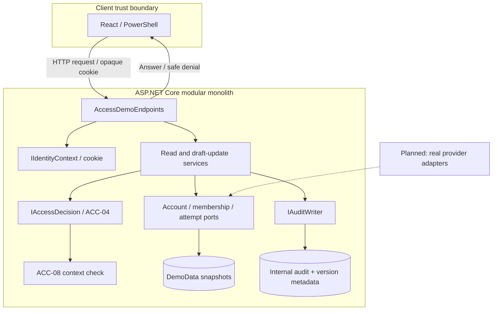
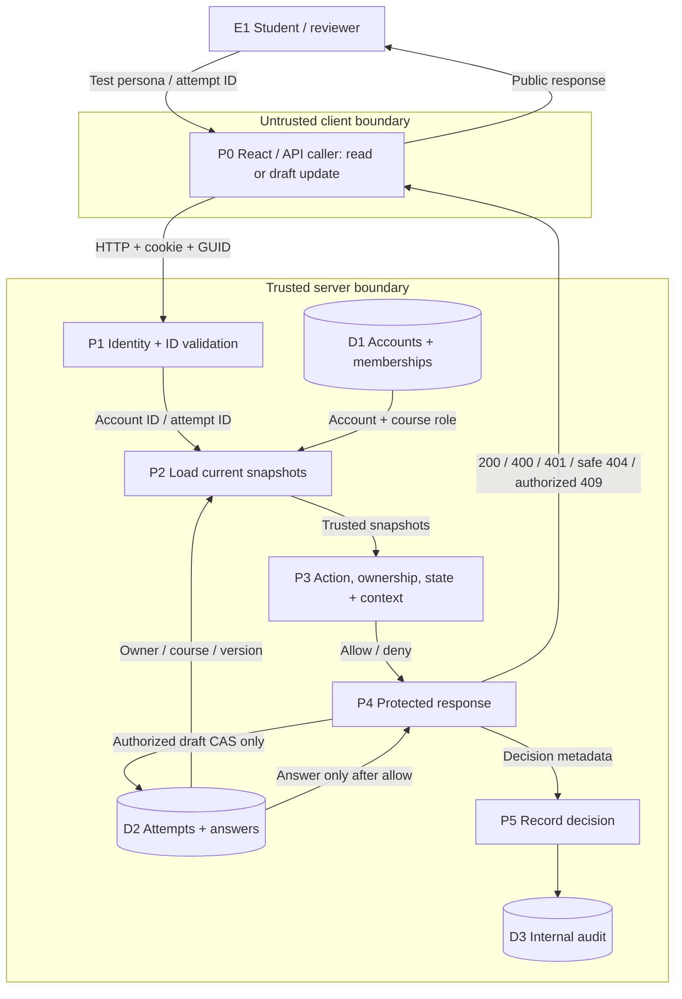

# Component ACC-04 - concrete-resource authorization (J)

**Requirements:** ACC-04; relevant shared rules SEC-01 and section 2.1. ACC-05-style default deny is a guard, not a separate claimed assignment.

## Responsibilities and boundaries

The server decides whether a particular authenticated account may read a particular attempt or update its own draft answer.
The client supplies an attempt GUID; it cannot choose authoritative owner, course, role or account status.
A protected development cookie identifies a known synthetic account. Account activity and membership are read again for every request.
This is a development demonstration of the application rule, not finished institutional authentication.

`AttemptReadService` obtains metadata through module ports, calls `IAccessDecision`, then reads answer content only after allow and only for the exact authorized snapshot/version.
It emits an internal metadata audit for the decision. Foreign and missing resources have identical status/body, including membership/context unavailability. No timing-equivalence claim is made.
The course teacher/reviewer exception is explicit and scoped; technical admin status never grants automatic answer access.

## Component architecture

## Data flow diagram

D1/D2/D3 are logical stores owned by the local synthetic adapter at KT1, not real shared database tables.
The future provider adapters shown with dashed lines are planned. The client boundary is untrusted; the API validates the cookie and resolves all authorization snapshots on the server.

## Security matrix

| Subject / course relation | Action and resource | Context | Result |
| --- | --- | --- | --- |
| Active owner, active membership | Read own attempt | Allowed window | Allow |
| Other student in same course | Read foreign attempt | Allowed window | Deny |
| Teacher of the attempt's course | Read submitted/completed attempt | Allowed window | Allow |
| Teacher of another course | Read attempt | Allowed window | Deny |
| Assistant without explicit review delegation | Read foreign attempt | Allowed window | Deny |
| Technical admin without course membership | Read attempt | Allowed window | Deny |
| Blocked account or inactive membership | Read attempt | Any | Deny |
| Any caller | Unknown operation | Any | Deny |

The initial teacher rule deliberately keeps another owner's unsubmitted draft private. This rule and the teacher scope exception must be reviewed with the attempt/course owners before production integration.

## Code and tests

- `backend/Platform.Api/Modules/Access/Contracts.cs`: provider and decision interfaces.
- `AccessPolicy.cs`: base ownership/course decision and default deny.
- `AttemptReadService.cs`: orchestration, safe response and audit.
- `Demo/`: explicit development-only adapters and routes.
- `backend/Platform.Access.Tests/AccessPolicyTests.cs`: ownership, role, course, inactive membership and unknown action.
- `AccessHttpTests.cs`: IDOR, spoofed caller headers/query values, foreign/missing equality, unavailable dependencies and per-request account state.

## Next steps

Replace the account/membership/attempt fixtures through agreed interfaces, integrate actual IIdentityContext, extend relevant operations, and verify current authorization after ownership/membership changes without rewriting historical evaluation records.
Run and evidence: [DEMO.md](DEMO.md), [VALIDATION.md](VALIDATION.md).

## KT1 draft-update extension

`AttemptDraftService` implements the second primary operation, `UpdateDraftAnswer`, through the proposed `IAttemptDraftWriter` port. Only an active owning student with matching active membership, an InProgress snapshot and valid context may change answer content. A positive expectedVersion and 1-4000 character nonblank answer are required. The synthetic adapter atomically compares the authorized snapshot and version, preserves owner/course/status/policy binding, and increments Version once. Submitted/Completed data is immutable.

See [common model and full two-action matrix](DOMAIN_MODEL.md), [threat traceability](THREAT_MODEL.md), [backlog](BACKLOG.md) and [proposed contract](CONTRACTS.md). The provider contract still needs a real neighboring-team review.

Additional tests: `DraftPolicyTests`, `AccessDraftHttpTests`, `AttemptPortContractTests`. The real audit test checks the change's actor/target/time/correlation and before/after versions without recording content or session data.
