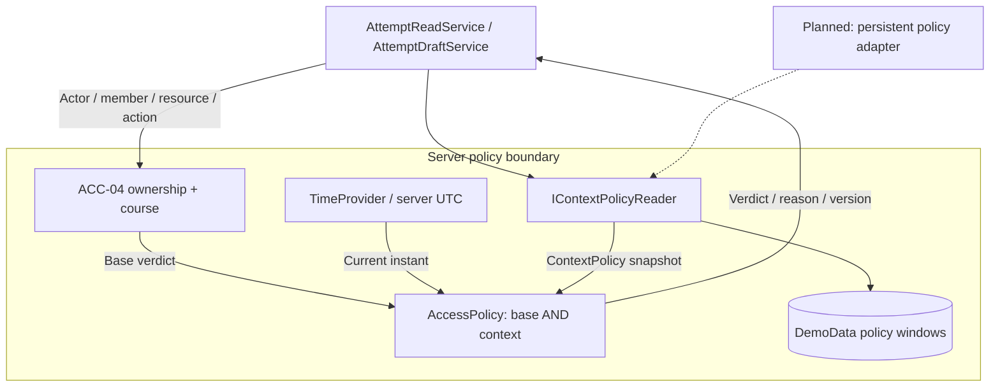
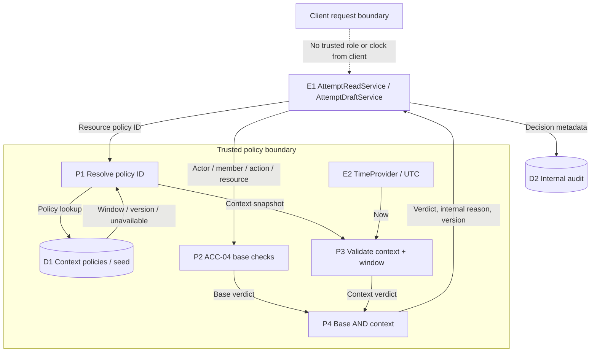

# Component ACC-08 - contextual access policies (N)

**Requirement:** ACC-08. The specification's TYP-06 ABAC laboratory is a different P-level requirement and is not claimed as implemented.

## Responsibilities and boundaries

This initial policy combines ACC-04 authorization with a server-supplied context window.
An owner with an expired window is denied; an active window cannot grant a foreign student access.
An explicit course review permission still requires the matching active course membership and a reviewable attempt state.
Role labels and attributes never create an unconditional owner/scope bypass.

`ContextPolicy` contains an exact policy ID/version and optional NotBefore/NotAfter instants.
`AccessPolicy` evaluates the start inclusively and the end exclusively using TimeProvider UTC.
Missing, mismatched, unversioned or invalid context fails closed. Empty time bounds mean a deliberately configured unrestricted window, not missing policy data.

## Component architecture

## Data flow diagram

The caller and policy evaluator are inside the same modular monolith. E1 is external to the policy process, not a network microservice. D1 is the synthetic policy store, D2 the internal audit. The client cannot supply the authoritative clock or membership.

## Security and test evidence

- `ExpiredContextDeniesEvenOwner`, `ContextCannotGrantForeignResource`, `TeacherCannotReadAnotherCourse`.
- `MissingContextIsDenied`, `WrongContextIdentityIsDenied`, `UnversionedPolicyIsDenied`.
- `WindowStartIsInclusive`, `WindowEndIsExclusive`, `InvalidWindowFailsClosed`.
- HTTP `OwnerCanBeDeniedByContext`; dependency-outage equality regression.

These are tests of a first context rule. This KT1 does not implement a generic policy language, policy CRUD, full ABAC engine, MFA, classification lifecycle or real institutional integration.

## Next steps

Agree real contextual attributes/providers, policy ownership/version semantics and explicit reviewer rules. Add missing-attribute, policy-change and adapter integration tests. Keep base checks mandatory for each relevant API request. Do not copy the old SCUTUM deployment architecture into this monolith.
Run and evidence: [DEMO.md](DEMO.md), [VALIDATION.md](VALIDATION.md).

## Both primary actions use context

The same context restriction applies to `ReadAttempt` and `UpdateDraftAnswer`. A teacher's review permission is read-only; a valid context never grants another student or reviewer permission to modify a draft. `ChangedContextIsRecheckedBeforeWrite`, `ExpiredContextPreventsDraftMutation` and `ValidContextCannotGrantForeignDraftWrite` cover these boundaries.

The full matrix and ownership are in [DOMAIN_MODEL.md](DOMAIN_MODEL.md); the asset-to-test chains are in [THREAT_MODEL.md](THREAT_MODEL.md). The prepared use cases and KT2 prerequisites are in [BACKLOG.md](BACKLOG.md). Production policy/provider review remains explicit in [CONTRACTS.md](CONTRACTS.md).
