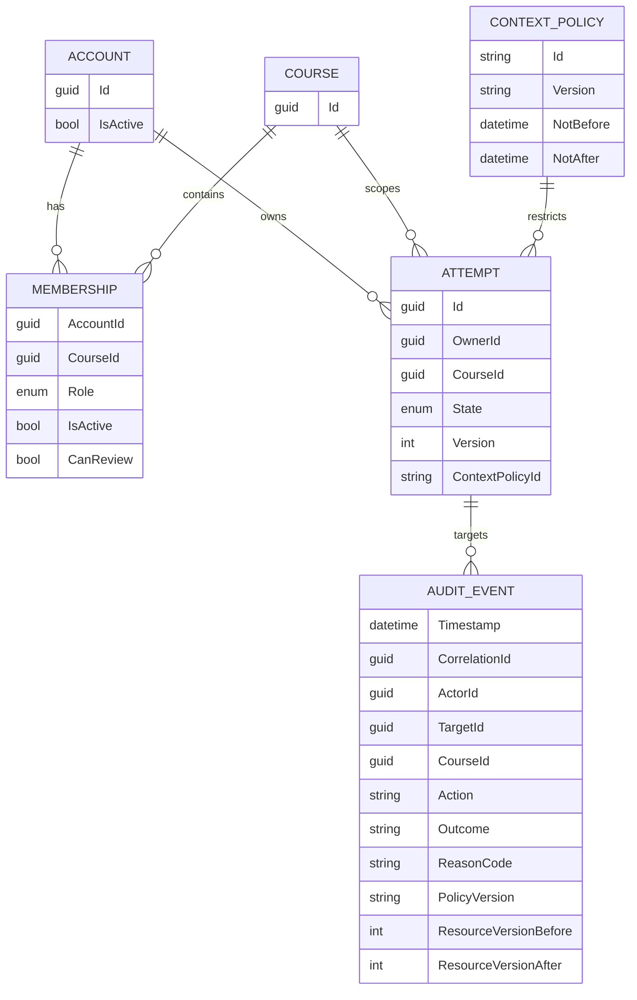
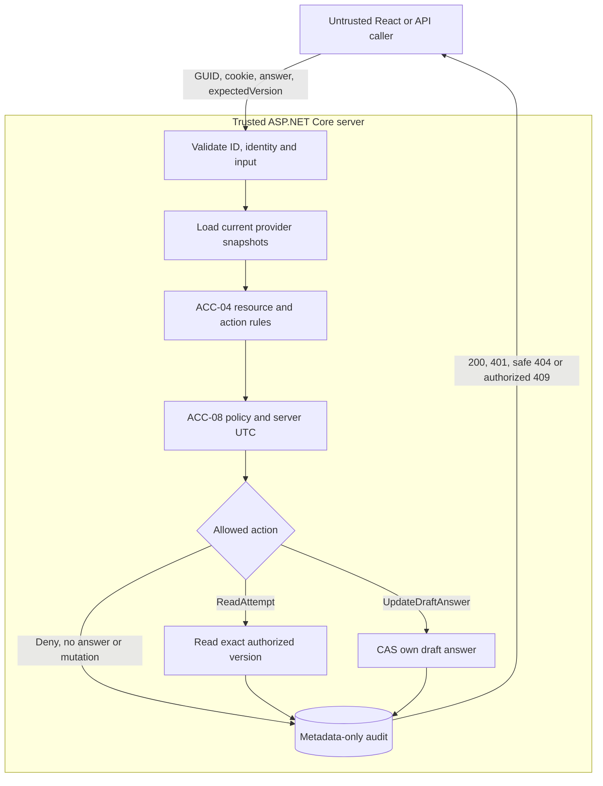

# Shared domain model, state and ownership

Scope: ACC-04 (resource access) and ACC-08 (context restriction), in the existing modular monolith. The client is untrusted. These two components consume snapshots from provider modules; the current `DemoData` adapter owns only synthetic local records.

`COURSE` is a logical identity reference in this KT1, not a newly implemented course-management entity/table. Audit actor may be absent for an anonymous request; a denied target may not exist. Diagram relationships show intended semantic references, not database foreign keys in this in-memory adapter.

## State and authoritative data

| Data | Current representation | Domain owner / proposed integration | Consumer responsibility |
| --- | --- | --- | --- |
| Account | `AccountSnapshot(Id, IsActive)` | Identity/account provider | Re-read current activity on each relevant request; never trust client role/status |
| Course membership | AccountId, CourseId, Student/Teacher/Assistant, IsActive, CanReview | Course/membership provider | Match both account and course; require current active membership |
| Attempt | Id, OwnerId, CourseId, InProgress/Submitted/Completed, Version, ContextPolicyId | ATT provider; synthetic `DemoData` at KT1 | Authorize exact resource; never let a caller choose owner/course/status |
| Answer | Content and version | ATT provider | Read only after allow; update only own InProgress answer through CAS |
| Context policy | ID, version, optional NotBefore/NotAfter | ACC-08 policy provider; synthetic window at KT1 | Validate identity/version and bounds; use server UTC |
| Audit | Actor/action/target/course/time/outcome/reason/version | Audit port; bounded in-memory queue at KT1 | No answer text, password, cookie or token |

The provider-domain assignments are a proposed ownership boundary, not a claim of an accepted inter-team agreement. See [CONTRACTS.md](CONTRACTS.md).

## Two implemented primary operations

1. `ReadAttempt`: active owner may read; an explicit reviewer may read submitted/completed attempts in the matching course. Another owner's InProgress answer is private.
2. `UpdateDraftAnswer`: only an active owning student with matching active membership can update an InProgress answer, in a valid context and at the expected version.

An update changes only answer content and Version. OwnerId, CourseId, State and ContextPolicyId are retained. Version increments exactly once. Submitted/Completed data is never rewritten. There are no submit/complete/owner-transfer APIs here; those lifecycle transitions belong to the ATT boundary and later agreed work.

## Combined flow and trust boundary

The client sends identifiers and proposed content/version, never authoritative identity, role, membership, clock, owner or resource state. Read/write services re-read snapshots before evaluating the requested action. Storage compares the entire authorized snapshot atomically before changing a draft.

## Minimal Subject-Action-Resource-Allow/Deny matrix

| Subject and relation | Action | Resource/status | Context / other condition | Decision |
| --- | --- | --- | --- | --- |
| Active owning student, active matching membership | ReadAttempt | Own attempt, known status | Valid window | Allow |
| Other student | ReadAttempt | Foreign attempt | Even valid window | Deny |
| Teacher / explicitly delegated assistant of same course | ReadAttempt | Foreign Submitted/Completed attempt | Valid window | Allow under explicit review rule |
| Teacher / reviewer | ReadAttempt | Another owner's InProgress attempt | Any window | Deny |
| Teacher of another course | ReadAttempt | Foreign attempt | Any window | Deny |
| Technical-admin test account without membership | ReadAttempt | Attempt | Any window | Deny |
| Active owning student | UpdateDraftAnswer | Own InProgress attempt | Valid input/window and exact version | Allow; answer changes and version increases |
| Other student / reviewer | UpdateDraftAnswer | Foreign InProgress attempt | Even valid window and supplied owner/role fields | Deny; no state change |
| Owner with non-student course role | UpdateDraftAnswer | Own InProgress attempt | Valid window | Deny in this initial rule |
| Owner | UpdateDraftAnswer | Own Submitted/Completed attempt | Any window | Deny; history unchanged |
| Otherwise authorized owner | Either | Own attempt | Expired/future/missing/invalid context | Deny |
| Inactive account or membership | Either | Any attempt | Any window | Deny |
| Authorized draft owner | UpdateDraftAnswer | Own InProgress attempt | Stale expectedVersion | Conflict; no state change |
| Caller | Either | Missing/foreign resource with unavailable provider | Unavailable | Safe denial; no existence disclosure in status/body |
| Caller | Unknown action | Any resource | Any context | Deny |

Teacher review is an explicit multi-condition rule, not an unconditional role bypass. The exact production rules and resource-status vocabulary remain subject to the neighboring-team contract review. The `admin` fixture proves no automatic membership bypass; this is not a complete global-admin permission model.
