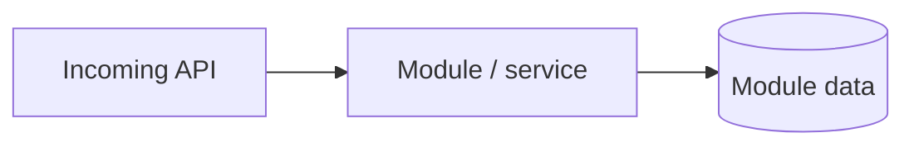
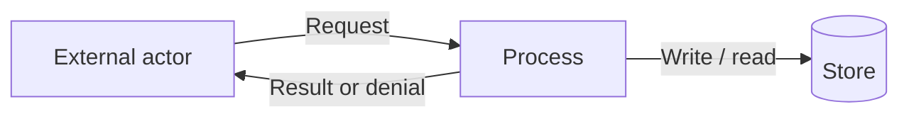

# Project component: [ID, name]

**Team:** [number]

**Student:** [name / student ID]

**Specification requirements:** [e.g. LAB-01, ATT-03]

## Responsibilities and boundaries

- Processes and user scenarios:
- Contracts with other modules:
- Implementation status:

## Component architecture

Replace the example with the actual architecture.

## Data flow diagram

Replace the example with actual flows and trust boundaries.

## Security requirements

- Server-side access checks:
- Input validation and sensitive data:
- Negative scenarios:

## Evidence of work

- Changed files / commit / pull request:
- Run instructions:
- Tests and results:
- Next steps:
