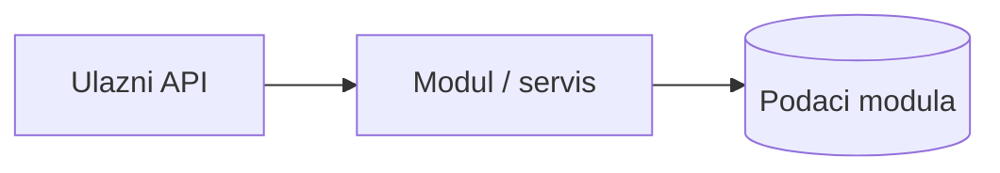
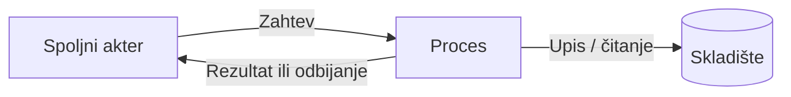

# Projektna celina: [ID, naziv]

**Tim:** [broj]  
**Student:** [ime / indeks]  
**Zahtevi nove specifikacije:** [npr. LAB-01, ATT-03]

## Odgovornost i granice

- Obuhvaćeni procesi i korisnički scenariji:
- Ugovori prema drugim modulima:
- Stanje implementacije:

## Dijagram arhitekture dela

Zameniti primer stvarnom arhitekturom.

## Dijagram toka podataka (DFD)

Zameniti primer stvarnim tokovima, uključujući granice poverenja.

## Bezbednosni uslovi

- Provere server-side pristupa:
- Validacija ulaza i osetljivi podaci:
- Negativni scenariji:

## Dokazi rada

- Izmenjeni fajlovi / commit / PR:
- Način pokretanja:
- Testovi i rezultat:
- Sledeći koraci:
