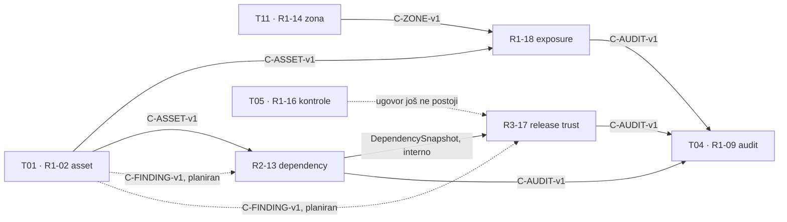

# T08 — Attack surface, supply chain i release trust

> **Status:** `scaffold` (prazan šablon). Kada servis dobije `tests` profil koji prolazi, promenite
> `status: active` u [`service.yaml`](service.yaml) — od tada ga CI testira na svakom PR-u.
> Pravila strukture i konvencija: [README u korenu repozitorijuma](../../README.md).

## Odgovornost tima

Projektne celine:

- **R1-18** — External exposure i attack-surface registry
- **R2-13** — Dependency i software supply-chain registry
- **R3-17** — Software provenance i release trust verifikacija

Tim:   ·  Stack: nije odabran (specifikacija preporučuje .NET / C#; drugi stack uz odobrenje nastavnog tima)

<!-- Jednom rečenicom: šta ovaj servis radi i šta NE radi (granica odgovornosti). -->

## Pokretanje

Linux / WSL / Git Bash:

```bash
bash scripts/scutum.sh network      # jednom po računaru
bash scripts/scutum.sh up t08          # api + baza
curl http://localhost:8008/health  # očekivano: OK
bash scripts/scutum.sh test t08        # isto što radi CI
bash scripts/scutum.sh down t08        # dodajte --volumes da obrišete podatke baze
```

Windows PowerShell / Command Prompt:

```powershell
scripts\scutum.bat network
scripts\scutum.bat up t08
curl http://localhost:8008/health
scripts\scutum.bat test t08
scripts\scutum.bat down t08
```

Preduslovi, izbor terminala i rešavanje problema opisani su u [README u korenu
repozitorijuma](../../README.md#preduslovi-i-brzi-početak-prvi-put-na-računaru).

| Šta | Gde |
| --- | --- |
| API (spolja) | `http://localhost:8008` (unutar mreže `scutum-net`: `http://t08-api:8080`) |
| UI / demo (opciono) | `http://localhost:8108` |
| Baza (samo za vaš alat) | `127.0.0.1:3408` |
| Konfiguracija | `.env` (iz `.env.example`), bez tajni u repozitorijumu |

Migracije, seed/demo podaci i potrebne promenljive okruženja: <!-- opisati gde su i kako se pokreću (SEC-OPS-02, SEC-OPS-03) -->

## Zavisnosti od drugih timova

Mapa zavisnosti (strelica ide od owner-a ka consumeru). Dok upstream servis ne postoji, T08 koristi stub sa
normalnim i failure ishodom koji ne sadrži security logiku drugog tima (SEC-DEP-01..05).



| Servis / ugovor | Owner | Kako ga koristimo | Stanje ugovora | Stub u razvoju |
| --- | --- | --- | --- | --- |
| [`C-ASSET-v1`](../../contracts/t01/C-ASSET-v1/) | T01 (R1-02) | `GET /api/v1/assets/{id}` — vlasnik, kritičnost, status, scope (R1-18-UC2, R2-13) | DRAFT (predlog T08) | da |
| [`C-ZONE-v1`](../../contracts/t11/C-ZONE-v1/) | T11 (R1-14) | `GET /api/v1/zones/{id}` — vlasnik i status zone (R1-18-UC2) | DRAFT (predlog T08) | da |
| [`C-AUDIT-v1`](../../contracts/t04/C-AUDIT-v1/) | T04 (R1-09) | `POST /api/v1/events` — polja iz SEC-CONV-04 (sve tri celine) | DRAFT (predlog T08) | da (`InMemoryAuditSink`) |
| `C-FINDING-v1` | T01 (R2-11) | nalazi po asset-u (R2-13, R3-17); vezu nalaz ↔ verzija držimo mi | planiran (T01: posle KT2) | da, tek za R2-13/R3-17 |
| ugovor kontrola (R1-16) | T05 | `GET /api/v1/controls/{id}` (R3-17) | ne postoji još | da, tek za R3-17 |
| identitet i dozvole (R1-03, R1-05) | T12, T02 | serverski kontekst `{ actorId, scope, permissions }` iz JWT-a (SEC-CONV-02) | nema ugovora | da (test JWT) |

## Ugovori koje ovaj servis nudi

Upisani su i u [`contracts/REGISTRY.md`](../../contracts/REGISTRY.md).

| Ugovor | Stanje | Consumeri |
| --- | --- | --- |
| `DependencySnapshot` (R2-13 → R3-17) | planiran DRAFT, piše par R2-13; još nije u registru | R3-17 (isti servis) |
| R1-18 nema consumera | — | po specifikaciji nijedna druga celina ne zavisi od R1-18 |

## Trust granica i bezbednost

- Threat model: [`docs/threat-model.md`](docs/threat-model.md)
- Odluke (ADR): [`docs/adr/`](../../docs/adr/) — fajlovi sa prefiksom `t08-`
- Demo scenario (normalan i negativan): [`docs/demo.md`](docs/demo.md)

## Poznata ograničenja i residual risk

<!-- Šta kontrola ne pokriva i zašto je rizik prihvatljiv ili otvoren. -->
