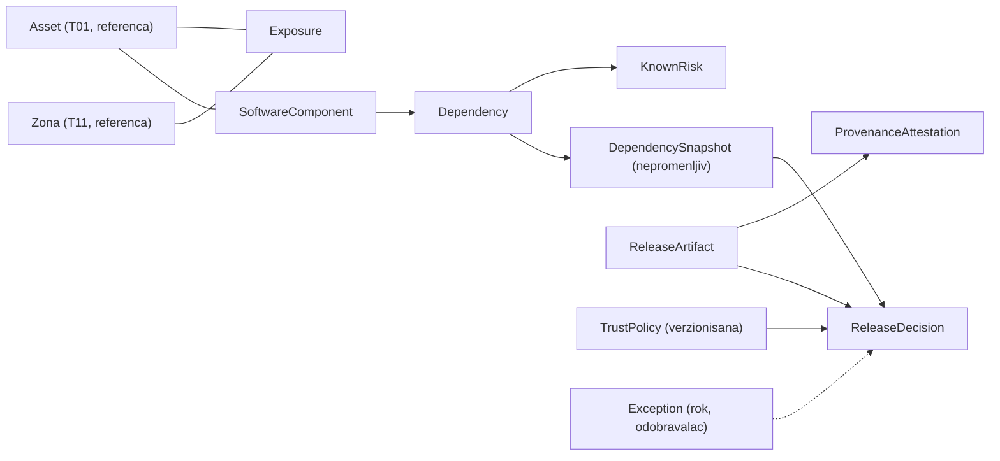
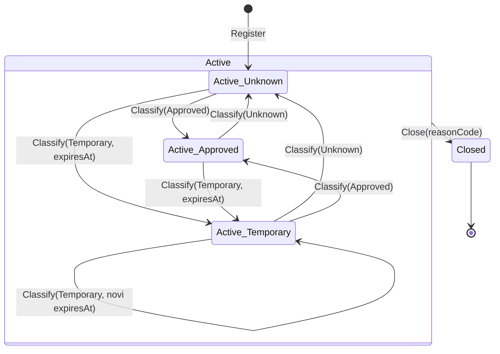

# Domen model: T08 (R1-18, R2-13, R3-17)

Jedan zajednički model za KT1. Detalji pojedinih UC-ova se dorađuju u PR-ovima; ovde su entiteti, statusi, vlasništvo i invarijante.
Tuđe podatke (asset, zona, nalaz, kontrola) čuvamo samo kao **referencu** (ID), nikad kopiju (SEC-CONV-10).

## R1-18 — Exposure

| Entitet | Ključna polja | Vlasnik / napomena |
| --- | --- | --- |
| `Exposure` | `id`, `assetId`, `zoneId`, `ownerId`, `endpoint` (domen/adresa), `port`, `protocol`, `purpose`, `justification`, `classification`, `status`, `lastConfirmedAt`, `nextReviewDue`, `expiresAt?`, `closedAt?`, `closeReason?` | `ownerId` = vlasnik exposure-a (identitet iz T12); mora postojati |
| `Classification` | `Approved`, `Temporary`, `Unknown` | `Unknown` znači **za proveru**, nikad „ranjivost" ni „bezbedno" |
| `ExposureStatus` | `Active`, `Closed` | `Closed` je terminalno, ostaje u istoriji |

Invarijante:

- Aktivan exposure ima vlasnika i poslovno obrazloženje.
- `Temporary` ima `expiresAt` u budućnosti; `Approved` i `Unknown` ga nemaju.
- Početna klasifikacija je `Unknown`. Prelaz u `Approved`/`Temporary` zahteva dozvolu klasifikovanja; povratak u `Unknown` je dozvoljen (ponovna provera).
- `Closed` exposure se ne menja i ne briše; pokušaj izmene se odbija stabilnim kodom.
- Promena klasifikacije ili statusa exposure-a čiji je asset `Critical`/`High` obavezno proizvodi audit događaj.
- Referenca na asset/zonu mora proći ugovor (`C-ASSET-v1`, `C-ZONE-v1`): nepoznat ili dekomisionisan asset i neaktivna zona se odbijaju.

### Prelazi stanja (Exposure)

| Operacija | Iz `Active` (bilo koja klasifikacija) | Iz `Closed` |
| --- | --- | --- |
| `Classify(cilj)` | dozvoljeno za svaki par (3×3); isto stanje sa istim istekom je no-op (bez nove verzije); `Temporary` traži budući `expiresAt`, ostali ga brišu/ne smeju imati | `EXPOSURE_CLOSED` |
| `Confirm` | dozvoljeno, ne menja klasifikaciju, podiže verziju (svaka potvrda je nov pregled) | `EXPOSURE_CLOSED` |
| `Close(reasonCode)` | dozvoljeno, zadržava klasifikaciju, `Closed` je terminalno | `EXPOSURE_CLOSED` |

Pokriveno testovima `ExposureTransitionMatrixTests` (svih 9 parova klasifikacije, sve operacije nad `Closed`). Statusi za `Dependency` i `ReleaseDecision` nisu definisani dok R2-13/R3-17 nisu započeti.

## R2-13 — Dependency / supply chain

| Entitet | Ključna polja | Napomena |
| --- | --- | --- |
| `SoftwareComponent` | `id`, `assetId`, `name` | veže se za asset |
| `Dependency` | `componentId`, `package` (ecosystem + name), `version`, `source` | `version` i identitet obavezni; `source = Unknown` je vidljiv risk signal |
| `KnownRisk` | `findingRef`, `severity`, `status` | vezan za **verziju**; vezu nalaz ↔ verzija držimo mi |
| `RemediationPlan` | `targetVersion`, `ownerId`, `dueDate` | |
| `Exception` | `reason`, `approverId`, `expiresAt` | odobravalac ≠ podnosilac; nikad ne briše nalaz |
| `DependencySnapshot` | `id`, `componentId`, `items[]`, `createdAt` | **nepromenljiv** posle kreiranja; interni ugovor ka R3-17 |

Invarijante: zavisnost bez verzije/identiteta se odbija; rizik se zatvara samo novom verifikovanom verzijom ili prihvaćenim izuzetkom; ponovljen uvoz ne duplira (idempotentnost).

## R3-17 — Release trust

| Entitet | Ključna polja | Napomena |
| --- | --- | --- |
| `ReleaseArtifact` | `id`, `name`, `digest`, `tag?` | odluka se vezuje za `digest`; sam mutable tag nije identitet |
| `ProvenanceAttestation` | `builder`, `sourceRef`, `builtAt`, `approvals[]` | simulirani podaci; to su **tvrdnje**, ne dokaz |
| `TrustPolicy` | `version`, `requiredEvidence[]`, `criticalThreshold` | verzionisana |
| `ReleaseDecision` | `releaseId`, `policyVersion`, `snapshotId`, `outcome` (`Allow`/`Warn`/`Block`), `reasons[]`, `decidedAt`, `exceptionRef?` | reproducibilna: čuva verziju policy-ja i snapshot |

**`ReleaseEvidence`** nije poseban entitet: to je zajednički naziv za dokaze koje `TrustPolicy.requiredEvidence[]` traži, a koje nose `ProvenanceAttestation` (builder, sourceRef, approvals) i `DependencySnapshot` (R2-13). Ako R3-17 zatraži zaseban entitet, dodaje se tu uz vlasnika i status; do tada se ne uvodi spekulativno.

Invarijante: nedostatak dokaza nije `Allow`; izuzetak ima rok i ne uklanja nalaz; digest se računa standardnom bibliotekom.

## Vlasništvo i scope

- Svaki resurs nosi `scope` (security domen) preuzet iz asset-a; čitanje i izmena traže poklapanje sa scope-om iz validiranog serverskog konteksta.
- Matrica dozvola: [`security-matrix.md`](security-matrix.md). Pretnje i kontrole: [`threat-model.md`](threat-model.md).
